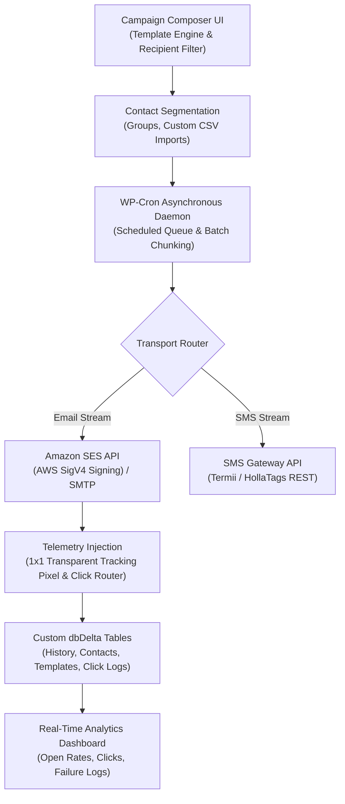

# 📡 Enterprise Broadcast & Telemetry Suite for WordPress

<p align="left">
  
  
  
  
  
</p>

A high-throughput, omni-channel messaging and engagement telemetry suite engineered from scratch for WordPress. Combines automated bulk email delivery (Amazon SES SigV4 API and SMTP), multi-provider SMS routing (Termii & HollaTags), scheduled background cron workers, and real-time open/click conversion telemetry inside a native WordPress administrative console.

---

## 🏗️ System Architecture



---

## ✨ Key Engineering Innovations

### 1. Dual Email Transport Pipeline (Amazon SES + Custom SMTP)
- **Direct AWS SigV4 Request Signing:** Generates SHA256 cryptographic authorization signatures for direct Amazon SES REST endpoints, bypassing standard mail bottlenecks.
- **PHPMailer Injection:** Features deep hook interception into WordPress's native PHPMailer pipeline (`phpmailer_init`) for custom TLS/SSL SMTP relaying.

### 2. Real-Time Telemetry & Tracking Gateway
- **Zero-Pixel Open Tracking:** Automatically injects unique base64-encoded transparent 1x1 tracking GIFs to record individual email opens without triggering spam heuristics.
- **Click-Through Redirection Router:** Encapsulates outbound hyperlinks with tokenized redirect routes to aggregate click-through telemetry per campaign.

### 3. Asynchronous WP-Cron Scheduling Engine
- Built with a fault-tolerant batch chunking queue leveraging WordPress Cron (`tka_broadcast_cron_hook`).
- Eliminates PHP maximum execution timeout (`max_execution_time`) issues when dispatching to large lists of 10,000+ contacts.

### 4. Custom Database Architecture via `dbDelta`
Maintains dedicated, normalized relational database schemas for high-speed indexing:
- `{$wpdb->prefix}church_broadcast_history` — Comprehensive audit trails, delivery counts, open totals, and click logs.
- `{$wpdb->prefix}church_broadcast_templates` — Reusable HTML campaign drafts and layouts.
- `{$wpdb->prefix}church_broadcast_contacts` — Recipient phone/email master index with multi-group taxonomy.
- `{$wpdb->prefix}church_broadcast_subscribers` — Automated opt-in and subscription state store.

### 5. Enterprise Security Standards
- **Nonce Authentication:** All AJAX endpoints and state modifications are strictly verified with `check_ajax_referer`.
- **Capability Isolation:** Administrative functions are gated behind `current_user_can('manage_options')` checks.
- **SQL Injection Immunization:** 100% of dynamic queries use `$wpdb->prepare()` with parameterized types.
- **Input Sanitization:** Deep recursive sanitization using `sanitize_text_field`, `sanitize_email`, and `wp_kses_post`.

---

## 🚀 Installation & Setup

1. **Download / Clone:**
   ```bash
   git clone https://github.com/solokool66/wp-broadcast-suite.git
   ```
2. **Deploy to WordPress:**
   Copy the `wp-broadcast-suite` directory into your WordPress plugins directory:
   ```text
   /wp-content/plugins/wp-broadcast-suite/
   ```
3. **Activate:**
   Go to your WordPress Admin Dashboard -> **Plugins** -> Activate **Enterprise Broadcast & Telemetry Suite**.
4. **Configure Settings:**
   - Navigate to the **Broadcast Suite -> Settings** tab.
   - Enter your Amazon SES credentials or standard SMTP server parameters.
   - Enter your SMS API Token (Termii or HollaTags).
   - Save settings and run a test transmission!

---

## ❓ Frequently Asked Questions (FAQ)

#### Q1: Does this require external third-party WordPress dependencies?
> **No.** This plugin is 100% self-contained. It leverages native WordPress core APIs, the native `$wpdb` database layer, and built-in HTTP request utilities (`wp_remote_post`).

#### Q2: What happens if my server experiences a timeout during sending?
> The system processes dispatches in segmented batches via WordPress Cron. If a batch is interrupted, the transaction status preserves the index and resumes automatically on the next scheduled cron cycle.

#### Q3: Can I import my existing recipient lists?
> **Yes.** The built-in address book features CSV import utilities with automated header mapping and group tag assignment.

---

## 👤 Author & Architecture

**Solomon, Kingsley Eze**  
*Software & Network Systems Engineer*  
- 💼 **LinkedIn:** [linkedin.com/in/solokool](https://www.linkedin.com/in/solokool/)  
- 🐙 **GitHub:** [@solokool66](https://github.com/solokool66)  
- 📧 **Email:** [solokool66@gmail.com](mailto:solokool66@gmail.com)  

---

## 📄 License
Licensed under the [GNU General Public License v2.0 or later](LICENSE).
